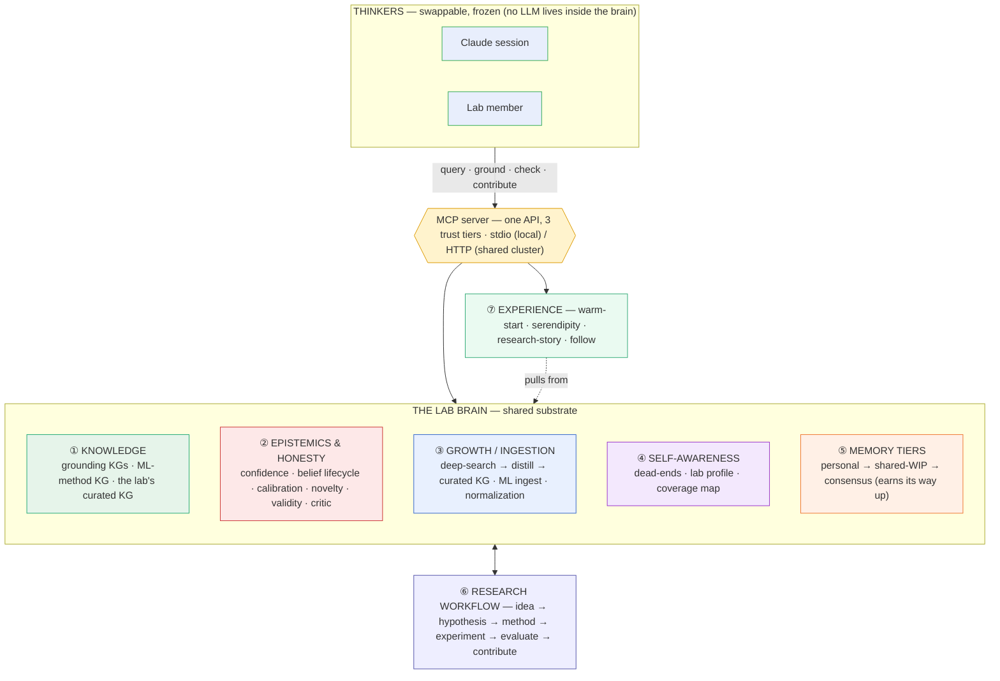
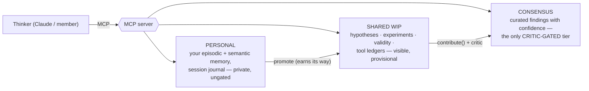
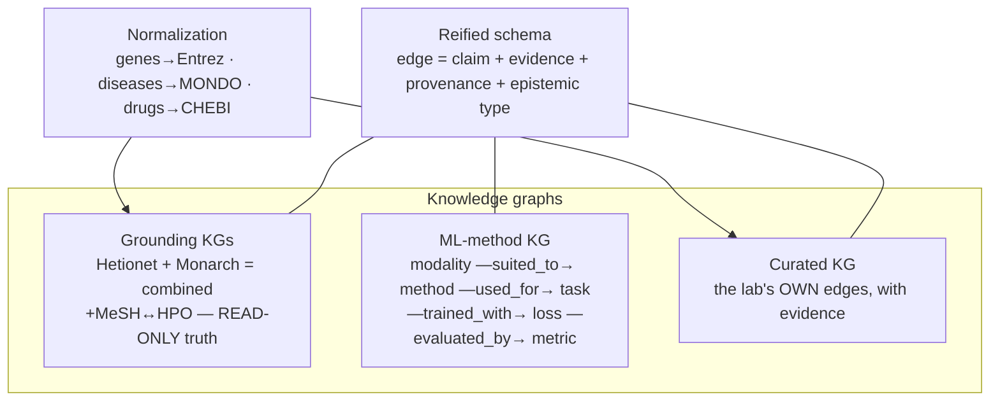
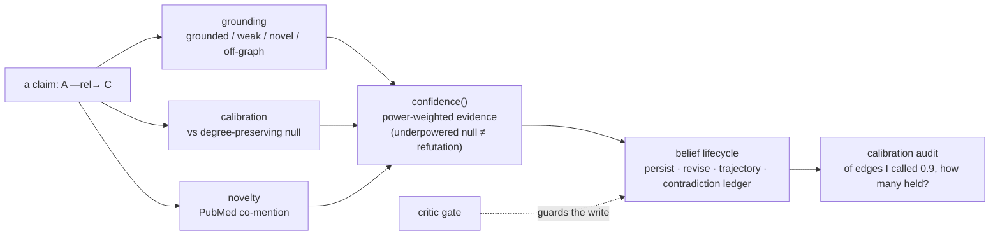
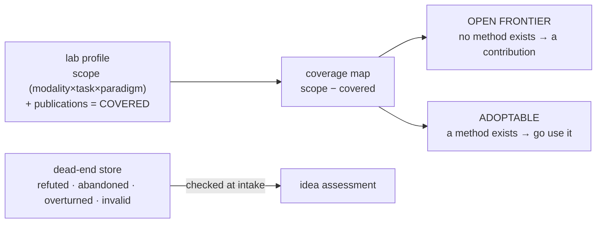
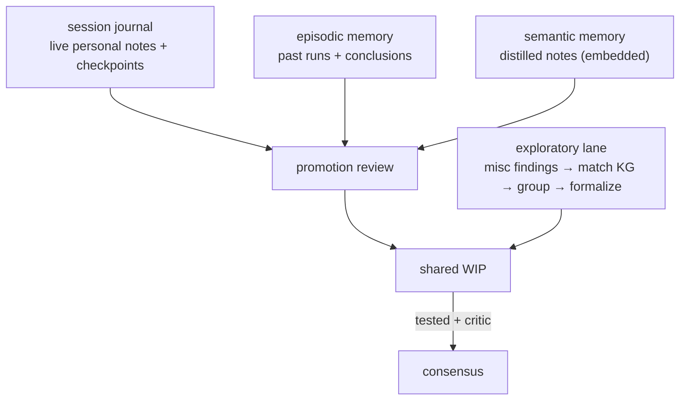
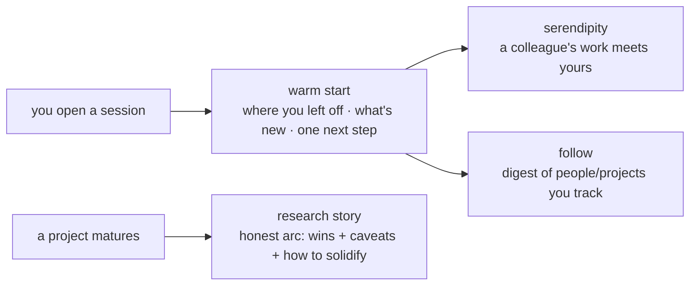
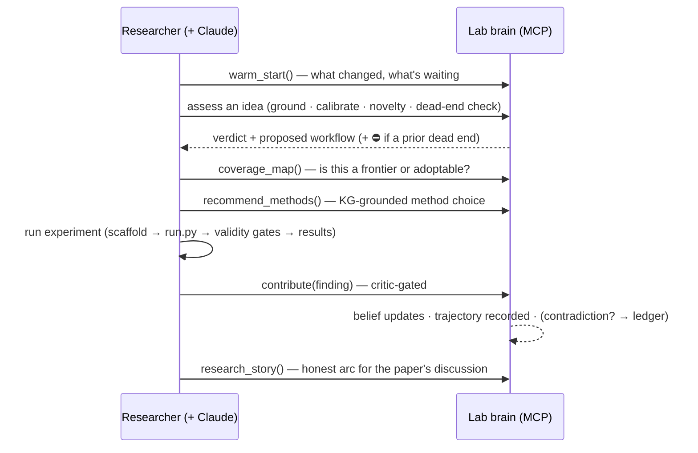
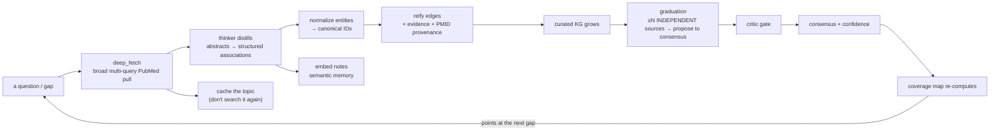
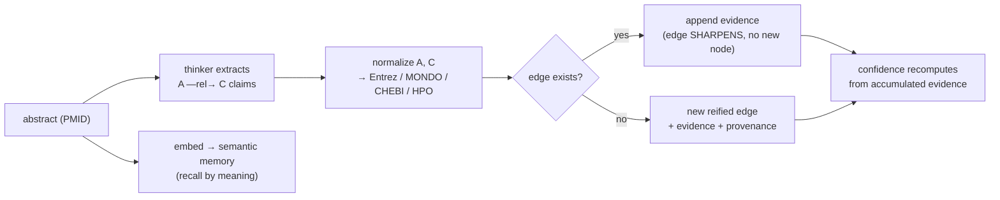

# The Lab Brain — architecture overview (presentation companion)

A talking-map of the whole system: one **parent diagram**, then a **zoom-in** per block, the
**intended workflow**, and **how the brain grows**. Every Mermaid block renders on GitHub and
pastes into most slide tools; each maps to real modules so you can drill from a slide to the code.

> **The one idea to open with.** This is a **substrate, not a thinker.** The intelligence (a Claude
> session, a lab member) is *swappable and lives outside*. What we built is the shared, LLM-free
> **brain** it stands on: the lab's knowledge, its evidence and confidence, its memory, and the
> rules that keep all three honest as they grow. Swap the thinker; the brain persists. (ADR-0030.)

---

## 1 · Parent diagram (the opening slide)

**Read it aloud as:** *thinkers* talk to the brain only through the **MCP server**, which enforces
three **trust tiers**. The brain has four faculties — what it **knows** ①, how it stays **honest**
②, how it **grows** ③, and how it knows **what it doesn't** ④ — all sitting on a **memory** ⑤ that
promotes knowledge from private to consensus. The **workflow** ⑥ is the loop researchers run through
it; the **experience** ⑦ layer is why they come back.

---

## 2 · Zoom-ins (one per subsequent slide)

### 2.1 · The MCP interface & the three trust tiers
*The single most important slide after the parent — it explains why a shared brain doesn't turn to mush.*

- **What:** `mcp_server.py` exposes tools in three tiers selected by `SUBSTRATE_SCOPE`
  (`personal | shared | all`). Knowledge is born **private**, becomes **visible process**, and only
  reaches **consensus** through a gate. Nothing is silently authoritative.
- **Edge that matters:** `promote → contribute()`. A finding must pass the **critic** and be
  normalized + attributed before it's part of what "the lab believes." (ADR-0031, 0032.)
- **Deploy:** one **HTTP** instance on the cluster serves everyone (per-request identity via a
  header); locally it's **stdio**, one per user. (ADR-0045.)

### 2.2 · Knowledge — three graphs, one grammar

- **What:** `kg_memory.py` (grounding), `ml_schema.py`/`method_select.py` (methods),
  `kg_writer.py` (the lab's curated edges), `kg_schema.py` (the reified grammar),
  `entity_norm.py`/`gene_norm.py` (canonical IDs).
- **Why three:** the grounding KGs are *trusted, fixed* reference; the ML KG makes **method choice a
  graph traversal**, not a lookup; the curated KG is where the lab's own knowledge *compounds*.
- **The grammar:** every edge is a **reified claim** — not a bare triple but a claim carrying its
  evidence, provenance, and epistemic type (definitional vs empirical). This is what lets the
  honesty layer reason about *how* something is known. (ADR-0006.)

### 2.3 · Epistemics & honesty — how a claim earns confidence
*This is the slide that makes methodologists trust it.*

- **What:** `confidence.py` (power-weighted evidence → status), `beliefs.py` (belief as **living
  state** — updates, keeps a trajectory, opens a contradiction ledger), `calibration.py` (the brain
  scores its **own** confidence), `novelty.py`, `validity.py` (pre-registered gates),
  `critic.py`/`eval_critic.py` (the gate). ADRs 0007–0010, 0053, 0054.
- **The honest core:** an **underpowered null is not a refutation** ("absence of evidence ≠ evidence
  of absence"); novelty ≠ truth; confidence **updates as evidence accrues** and is **auditable**
  against outcomes. This is the antidote to a brain that just gets more confident over time.

### 2.4 · Self-awareness — what the lab does NOT know

- **What:** `lab_profile.py` (the modular, per-lab frontier baseline), `coverage.py` (the gap map,
  adoptable vs open-frontier), `deadends.py` (negative knowledge, checked before you commit). ADRs
  0056–0058.
- **The pairing to say out loud:** **dead-ends mark *closed* avenues; the coverage map marks
  *unopened* ones.** Together: where not to go, and where to go next — both relative to *this lab's*
  actual work, at the method grain (not gene↔disease).

### 2.5 · Memory tiers & the exploratory lane

- **What:** `memory.py` (episodic), `semantic_memory.py` (embeddings), `session_journal.py` (keeps
  the personal tier alive mid-session), `misc_research.py` (ad-hoc analyses that still get
  rigor-checked and matched to the KG), `contribute.py`/`store_lock.py` (the guarded write path).
- **The point:** unstructured work isn't lost — a journal, an ad-hoc test, a hunch all have a
  **path** to becoming lab knowledge, but only by passing through rigor. (ADRs 0041–0044.)

### 2.6 · The experience layer (why people actually use it)

- **What:** `briefing.py`, `serendipity.py`, `subscriptions.py`, `research_story.py`. ADRs 0049–0051, 0055.
- **The stance:** personalize to the **work**, never the **person** — an assistant, not a twin
  (ADR-0052). The research story is deliberately **not** a highlight reel; it interleaves caveats.

---

## 3 · The intended workflow (the "day in the life" slide)

Two entry points, same brain: a **hypothesis-driven** run (idea → … → contribute) and an
**exploratory** run (ad-hoc analyses → misc findings → group → formalize). Both converge on the same
gated consensus.

---

## 4 · How the brain grows (the section you asked for)

Growth is a **governed flywheel**, not a dumping ground. New information enters through a few
pathways, becomes **normalized, reified nodes/edges**, and is **gated** so that *bigger stays
better*.

### 4.1 · The growth flywheel

The loop closes: **coverage** identifies a gap → a **deep search** fills it → distillation writes
**edges** → **graduation + critic** promote the well-corroborated ones → **coverage recomputes** and
points at the next gap. Each pass makes the brain both **bigger and more pointed at the lab's
frontier.**

### 4.2 · The ingestion pathways (how information gets in)
| Pathway | Trigger | What it creates | Module(s) |
|---|---|---|---|
| **Paper distillation** | a deep literature sweep | curated-KG **edges** + PMID provenance + cached topic | `deep_search.py` (`deep_fetch`→`record_distillation`) |
| **Contribution** | a finding (literature or experiment) | evidence merged onto an edge, belief updated | `contribute.py`, `beliefs.py` |
| **ML method ingest** | seeding/expanding methods | method/modality/task **nodes & edges** | `ml_ingest.py`, `ml_schema.py` |
| **Exploratory** | ad-hoc analyses | misc findings → grouped → formalized hypotheses | `misc_research.py` |
| **Experiment result** | a completed run | a provenance-verified finding → consensus | experiment → `contribute.py` |
| **Publications** | your papers | profile tags (modality×task×paradigm) = "covered" | `lab_profile.py` |
| **Scheduled refresh** | cron | re-distills **stale** topics so knowledge stays current | `refresh_stale.py` |

### 4.3 · How a paper becomes nodes & edges

Three things make this **encoding** honest and compounding:
1. **Normalization** collapses surface forms to canonical IDs, so "UC" and "ulcerative colitis" land
   on the *same* node — the graph doesn't fragment as it grows.
2. **Dedup-by-merge** means a paper seen in 3 studies **sharpens one edge** (accumulating evidence)
   rather than spawning duplicates — growth *concentrates* signal.
3. **Provenance + independence:** every edge carries its PMIDs; graduation counts **independent**
   sources (grouped by last-author) so a self-citing cluster can't inflate confidence.

### 4.4 · What keeps quality up as it scales
Growth without governance rots. Five guards run continuously:
- **Critic gate** — consensus is earned, not asserted (`critic.py`).
- **Grounding + calibration** — novel/weak claims are labelled, and confidence is audited against
  outcomes (`confidence.py`, `calibration.py`).
- **Power-weighted evidence** — underpowered nulls barely move belief; real refutations do.
- **Dead-ends + novelty** — the brain won't re-open closed avenues or mistake rediscovery for
  discovery (`deadends.py`, `novelty.py`).
- **Deep-search cache + scheduled refresh** — expensive sweeps happen **once**, are reused lab-wide,
  and are re-checked when they go stale (`deep_search.py`, `refresh_stale.py`).

### 4.5 · Scaling properties (grounded in measurement)
- **Cheap to grow.** The knowledge logs are ~**6 KB per session**; even a 50-person lab for a year
  is **< 1 GB** of generated data — a fraction of the fixed, *shared* reference KG.
- **Edges saturate.** New evidence merges into existing edges, so the curated KG grows **sub-linearly**
  in records while getting *more* corroborated.
- **Search is de-duplicated.** The distillation cache means the lab pays for a literature sweep
  **once**, not per person — the dominant *compute* cost, not storage, and it's bounded on purpose.
- **The watch-item is read latency, not disk.** Stores are full-scanned per call; comfortable to
  ~100K records (years out for a large lab), then an index/SQLite swap is the fix.

---

## 5 · Suggested slide order
1. **Substrate, not thinker** (the framing quote).
2. **Parent diagram** (§1).
3. **Trust tiers** (§2.1) — why a shared brain stays coherent.
4. **Knowledge: three graphs, one grammar** (§2.2).
5. **Epistemics / honesty** (§2.3) — earn the methodologists.
6. **Knows what it doesn't** (§2.4) — coverage + dead-ends.
7. **Memory tiers & exploratory lane** (§2.5).
8. **Experience** (§2.6) — adoption.
9. **Day in the life** (§3).
10. **How the brain grows** (§4) — the flywheel, ingestion table, paper→edges, governance, scaling.
11. Close on the flywheel image: *coverage finds the gap → search fills it → the brain grows toward the lab's frontier.*

> Every module named here has a one-line rationale in `docs/decisions/` (ADRs 0001–0058) — drill from
> any slide straight to the decision and the code.
